# How to use popcorn

popcorn (the app calls itself **Bone Spatial Studio**) runs the Visium HD bone-lesion analysis of the manuscript on
your own sections, in the browser. You upload the Space Ranger output of each section, check it, start the analysis
and read the results: a summary, the manuscript figures, every table and a map of every bin.

This guide follows the hosted version at **<https://backend.asagene.aurorarangers.ca/popcorn/>**. Its example is the
run [`r-20261109-173810-1337`](https://backend.asagene.aurorarangers.ca/popcorn/#/runs/r-20261109-173810-1337/viewer)
of the project *test*: the control section LL-2-1 and the tumor-bearing section RL-1-5 of SR007144, default settings.
To run popcorn on your own computer instead, see [On your own computer](#on-your-own-computer).

**In short**

1. **Projects → New project**.
2. **Data → Upload a Space Ranger folder…**, tick the sections, check control/tumor and the reference section.
3. Optional: **Explore** the raw data, adjust **Parameters**, **Signatures** and the **Region of interest**.
4. **Run → Start analysis** (about half an hour for two sections with the default steps).
5. Open the run: **Summary**, **Figures**, **Tables**, **Spatial viewer**; **Export** downloads everything.

**Contents:** [Before you start](#before-you-start) ·
[1. Create a project](#1-create-a-project) ·
[2. Upload the data](#2-upload-the-data) ·
[3. Look at the raw data](#3-look-at-the-raw-data-optional) ·
[4. Check the settings](#4-check-the-settings-optional) ·
[5. Start the analysis](#5-start-the-analysis) ·
[6. Read the results](#6-read-the-results) ·
[7. Use the spatial viewer](#7-use-the-spatial-viewer) ·
[8. Download the results](#8-download-the-results) ·
[9. Re-run and reproduce](#9-re-run-and-reproduce) ·
[Other tissues and gene sets](#other-tissues-and-gene-sets) ·
[When something goes wrong](#when-something-goes-wrong) ·
[On your own computer](#on-your-own-computer)

## Before you start

**Data.** For each Visium HD section, its Space Ranger output: the `outs/binned_outputs/` folder, or the `outs/` or
section folder above it. popcorn reads only these files, for the analysis bin size (16 µm by default) and the
quality-control bin size (8 µm):

```
SR007144_LL-2-1/outs/binned_outputs/
├── square_008um/
│   ├── filtered_feature_bc_matrix.h5
│   └── spatial/   tissue_positions.parquet (or .csv), scalefactors_json.json,
│                  tissue_hires_image.png, tissue_lowres_image.png
└── square_016um/
    ├── filtered_feature_bc_matrix.h5
    └── spatial/   (the same files)
```

The upload skips everything else: 42 MB for LL-2-1 and 64 MB for RL-1-5.

**Gene names.** The default gene signatures are the manuscript's mouse genes (Table 1). For human data or other tissues,
see [Other tissues and gene sets](#other-tissues-and-gene-sets).

**Browser.** A desktop browser (Chrome, Edge, Firefox or Safari): uploading a whole folder needs one.

**The hosted server is shared and has limits.**

* It has no accounts: everyone who opens the address works in the same workspace and sees the same projects and runs.
  Upload only data you may share; analyse confidential data [on your own computer](#on-your-own-computer).
* A project may upload up to 3.0 GB.
* The server has limited memory and stops an analysis after 30 minutes. The example run took 27 minutes;
  [Start the analysis](#5-start-the-analysis) says how to make a run shorter.

## 1. Create a project

Open <https://backend.asagene.aurorarangers.ca/popcorn/>. The sidebar leads to **Projects**, **Runs**, the **Guide**
(the built-in help: workflow, glossary, mouse and keyboard) and back to Geno Intelligence.

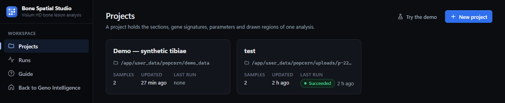

* **New project** → type a name → **Create project**. The project opens on its **Data** tab.
* **Try the demo** generates two small synthetic tibiae and a project with fast settings, to try every step without data
  of your own.

A project holds one analysis setup: the sections, the parameters, the gene signatures and any drawn regions. Every run
keeps a frozen copy of it, so changing the project later never changes a finished run.

## 2. Upload the data

In the **Data** tab of the project:

1. Keep the bin sizes at **16 µm** (analysis) and **8 µm** (quality control) unless you need others. Choose them before
   you upload: only the files of these two sizes are uploaded.
2. Click **Upload a Space Ranger folder…** and choose the folder of one section, or a folder that holds several (for
   the example, the folder that contains `SR007144_LL-2-1/` and `SR007144_RL-1-5/`). The browser may ask you to confirm
   the upload of a folder. A bar shows the progress; **Cancel** stops it and keeps the files already uploaded.
3. When the upload is done, the **Detected samples** dialog lists the sections it found. Tick them and click
   **Add selected**. Later, **Add samples…** opens the dialog again and **Remove uploaded data** deletes the files from
   the server.
4. Check the **Samples** table, one row per section in figure order:
   * **Ref.**: the reference section, the denominator of every fold change (normally the control);
   * **Id**, **Label** (used in the figures and tables), **Condition** (control, tumor or other) and **Color**;
   * **Data**: the number of bins, once the section has been read.

   Labels and conditions are guessed from the folder names: without a hint such as "ctrl" or "tumor", the first
   section becomes the control and the others tumor-bearing. Correct them here.
5. Scroll down to the **Data check**. It reads every section without running the analysis: the bin folders, positions,
   scale factors, H&E image, microns per pixel and which signature genes are in the probe set. **Errors** must be fixed
   before a run; **warnings** are worth a look but do not block it. The example has two: one gene of the host receptor
   panel (*Il11ra1*) and six ubiquitous transcripts are missing from the probe set.
6. Click **Save** in the bar at the bottom of the page (or press Ctrl+S).

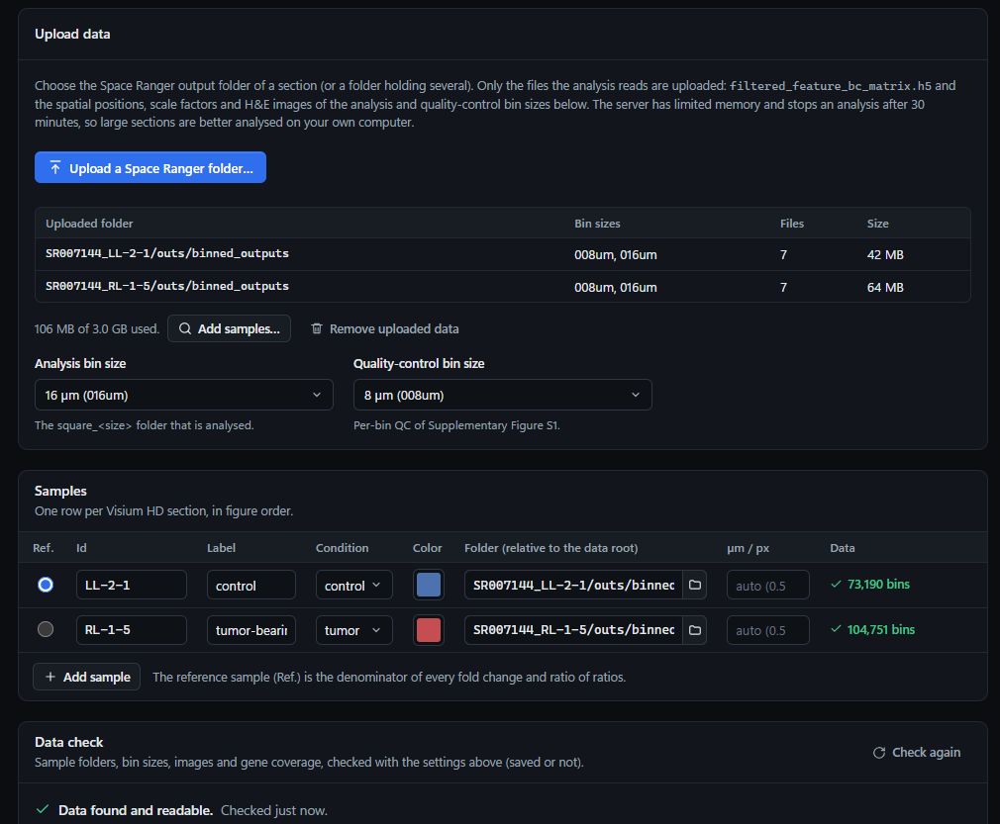

The chip at the top right of a project (**Settings valid**, or the number of errors and warnings) opens the full
configuration check at any time.

## 3. Look at the raw data (optional)

The **Explore** tab shows the sections as Space Ranger wrote them, before any run, with the current settings (saved or
not):

* a table of the bins, genes and UMIs of each section, the median UMIs, genes and mitochondrial share per bin, and how
  many bins pass quality control with the current thresholds;
* a map of the bins with the same controls as the [spatial viewer](#7-use-the-spatial-viewer), with the H&E image
  underneath when you switch it on;
* the genes of a section ranked by UMIs: click a gene to color the map by it; the **+** at the end of its row adds it as
  one more gene, in its own color.

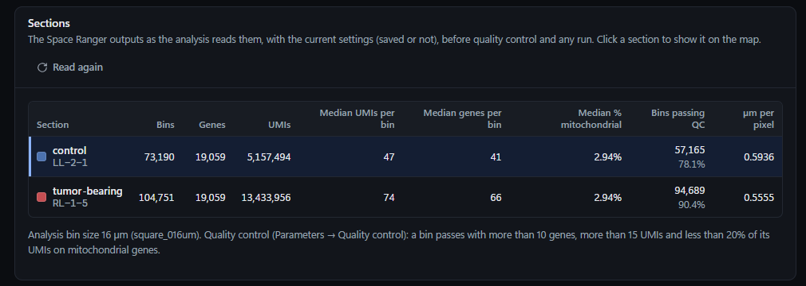

Use it to judge the quality-control thresholds (**Parameters → Quality control**) before you run. In the example, 78%
of the control bins and 90% of the tumor-bearing bins pass the defaults: more than 10 genes, more than 15 UMIs and less
than 20% of the UMIs on mitochondrial genes.

## 4. Check the settings (optional)

The defaults reproduce the manuscript. Every field explains itself and has a reset button.

* **Parameters**: quality control; normalization, embedding and Leiden domains; gene-set scoring and positivity; the
  region of interest; the figures; **Analysis steps** (switch steps on or off); the sensitivity analyses;
  reproducibility.
* **Signatures**: the gene sets of Table 1, with their scored genes, core genes, competing signatures and excluded
  genes, and which signatures get a positivity call (**P**) and which compete in the tissue assignment (**A**). After a
  data check, gene chips are green when the gene is in the probe set and red when it is missing.
* **Region of interest**: draw polygons on the H&E image of a section. **Draw** (D), click to add corners, Enter (or a
  double-click) closes the polygon, Esc cancels it, Backspace removes the last corner, Del removes the selected
  polygon, Ctrl+Z undoes. Then **Save region**, switch on **Use the drawn region in the analysis** and save the project.
  Without a drawing, the analysis uses its transcriptional region of interest, which leaves out the bins scoring
  highest for skeletal muscle, nerve and smooth muscle (the tissue around the bone).

## 5. Start the analysis

In the **Run** tab:

1. **What will run** lists the sections, the bin size, the drawn regions and the steps. Three slow steps have a switch
   that applies to this run only: Leiden seed stability, Moran's I and the three-gene-set sensitivity (off by default).
2. Optionally type a **Run label**, shown in the list of runs.
3. Click **Start analysis**. Unsaved changes are saved first, and the page of the new run opens.

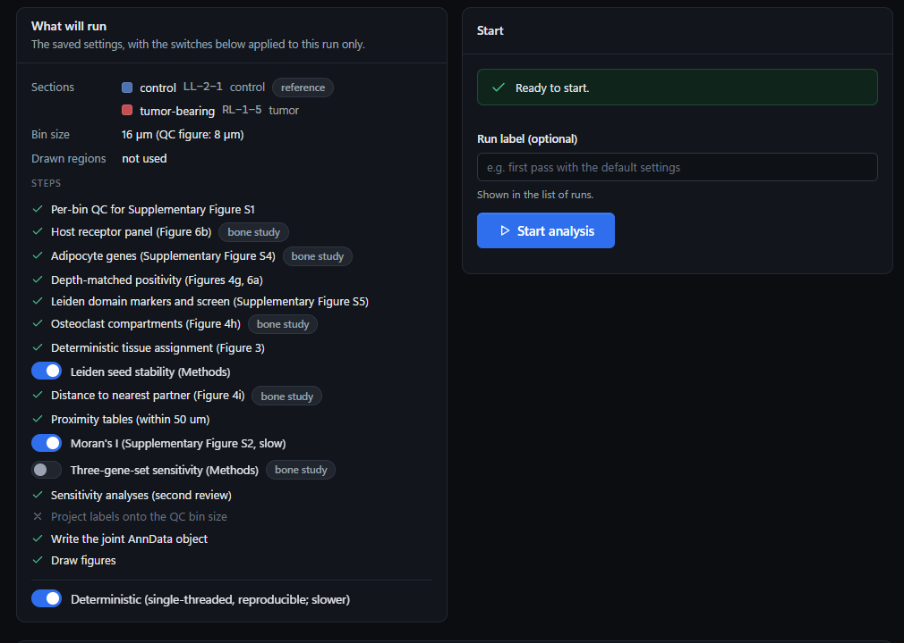

The **Progress** tab of the run shows every step with its time, the warnings and the live log. You can close the page:
the analysis goes on on the server. When the server is busy, a run waits in the queue (**Runs** page). **Cancel** at
the top of the run stops it.

**How long it takes.** The example run took 26 min 55 s for 40 steps. The longest were the Leiden domain markers and
screen (6 min 37 s), normalization, embedding and Leiden domains (6 min 7 s), the sensitivity analyses (6 min 5 s) and
Leiden seed stability (2 min 59 s). The hosted server stops an analysis after 30 minutes, so for larger sections, or
more of them, make the run shorter:

* switch off **Leiden seed stability** and **Moran's I** in the Run tab;
* switch off **Sensitivity analyses (second review)** and, if you do not need Supplementary Figure S5, **Leiden domain
  markers and screen** under **Parameters → Analysis steps**;
* or run popcorn [on your own computer](#on-your-own-computer), where there is no time limit.

**Deterministic** (on by default, at the bottom of the step list) runs single-threaded with fixed seeds, so that a
rerun reproduces every number.

## 6. Read the results

**Runs** lists every run; click one to open it. A finished run has six tabs:

| Tab | What you find there |
|---|---|
| **Progress** | every step with its time, the warnings and the log |
| **Summary** | the bins of each section after quality control and in the region of interest, the key numbers with Wilson 95% confidence intervals, warnings, skipped steps, timings and package versions |
| **Figures** | the manuscript figures with their captions; click one to see it full size and download it as PNG or PDF; **Download all** |
| **Tables** | every CSV the run wrote, each with a description, to sort, search and download, and the AnnData object (`.h5ad`) for work in Python |
| **Spatial viewer** | every bin at its position: see [the next section](#7-use-the-spatial-viewer) |
| **Configuration** | the frozen `config.json` of the run: copy, download, or **Create project from this configuration** |

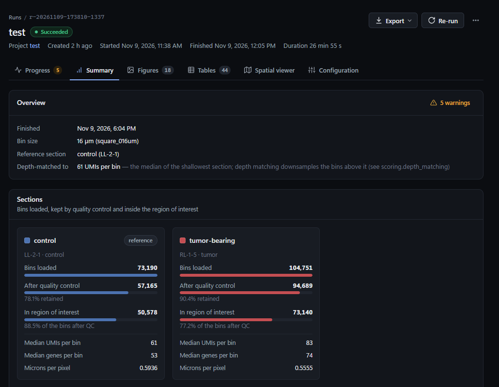

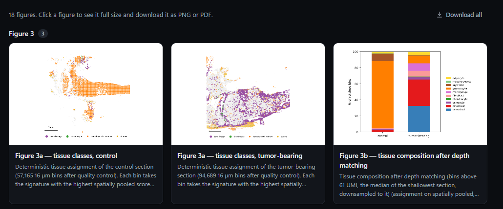

## 7. Use the spatial viewer

The **Spatial viewer** tab draws every bin of a section at its position
([the example](https://backend.asagene.aurorarangers.ca/popcorn/#/runs/r-20261109-173810-1337/viewer)).

The bar at the top applies to every panel: **Panels**, **Pan and zoom → Linked**, **Color scales → Shared**, **Point
size**, **H&E image** (**Show**, and a slider for how much of it shows through the bins) and **Save PNG** (the panels
with their legends). Each panel has its own **Section** and one of three colorings:

* **Color by genes**: one gene per line (**+ Add layer** adds a line);
* **Color by cells**: one cell type per line (**+ Add cell type** adds a line);
* **Or color by → Top gene**.

Only one coloring is drawn at a time. The lines of the others stay, and **Show** on one of their lines draws them again.

### One gene

Type a gene in **Color by genes** (suggestions appear as you type; ↑, ↓ and Enter pick one) and click **Show**. The
bins are shaded by the gene's UMIs on a logarithmic scale. The colors stop at the 99th percentile (marked ≥ in the
legend), so that a few extreme bins do not flatten the map. The legend says in how many bins the gene is detected: for
*Ctsk* in RL-1-5, 3,161 of 94,689 bins (3.3%).

### Several genes, each in its own color

Click **+ Add layer**, type a second gene in the new line and click **Show**. Every gene now has its own color, shown
next to its line, and a bin detecting several genes takes the color of their combination. Zoomed in, each combination
also has a shape (circle, triangle, diamond, star, …), and touching bins of a combination are outlined together as a
cluster. The colors are chosen to contrast with each other, with the gray bins and with the background.

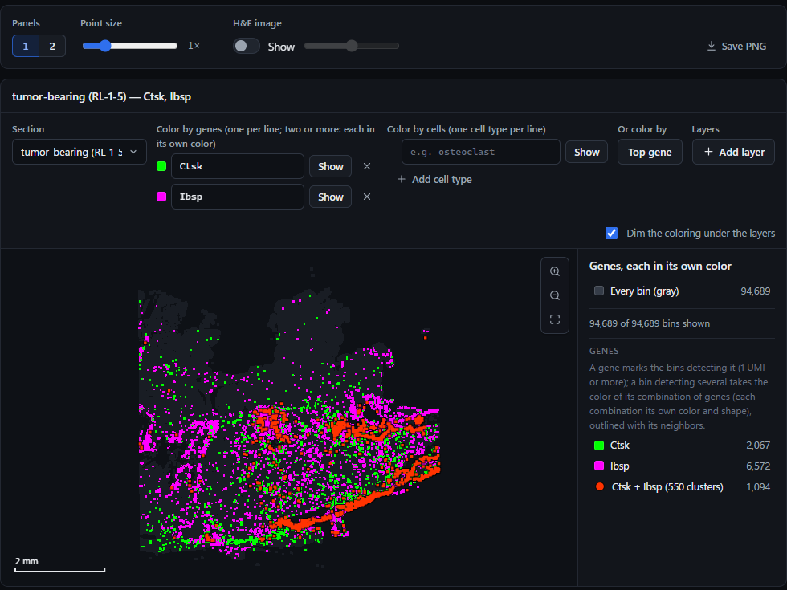

In the example, *Ctsk* alone marks 2,067 bins, *Ibsp* alone 6,572, and 1,094 bins in 550 clusters detect both.

* `Ctsk, Ibsp` typed on one line becomes two lines; `Ctsk + Acp5` stays one line and sums the two genes.
* **×** removes a line; **Dim the coloring under the layers** fades what lies underneath.

### Cell types and where they overlap

**Color by cells** (on the map of a run) colors the bins by the cell type the analysis assigned them to: the gene
signature of the tissue assignment, in the colors of the Signatures tab. Type or pick one cell type per line (the list
gives the bins of each type) and click **Show**; **All cell types** in the list colors every type. The picked types are
drawn in their colors and every other bin in gray.

With two or more types picked, the bins called positive for two or more of them (positivity calls at native depth) take
the color and shape of their combination, are joined into clusters with a bright outline, and are listed under
**Overlap** in the legend.

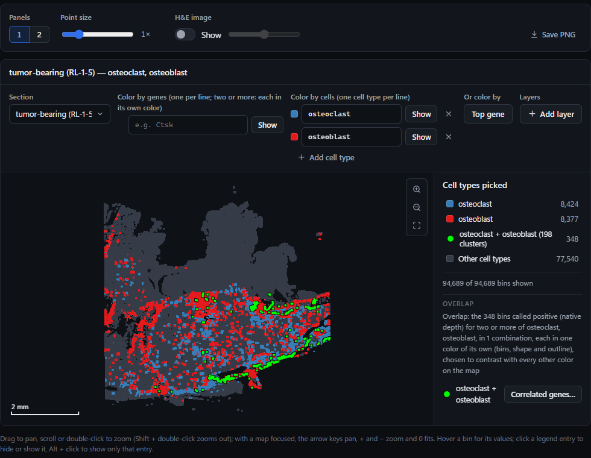

In the tumor-bearing section, 348 bins in 198 clusters are positive for both osteoclast and osteoblast.

**Correlated genes…** next to a combination finds the genes that follow it. Every gene of the section is tested: the
Pearson correlation of its expression (log1p of its UMIs per 10,000 UMIs of the bin) with being in the overlap or not,
a t test and the Benjamini–Hochberg FDR. A gene passes with r ≥ 0.1, FDR ≤ 0.05 and detection in at least 3 bins of the
overlap; change the thresholds and press **Find genes** to ask again. **Show** colors the map by a gene, **Show top 3
as gene lines** draws the first three together and **Copy list** copies the table.

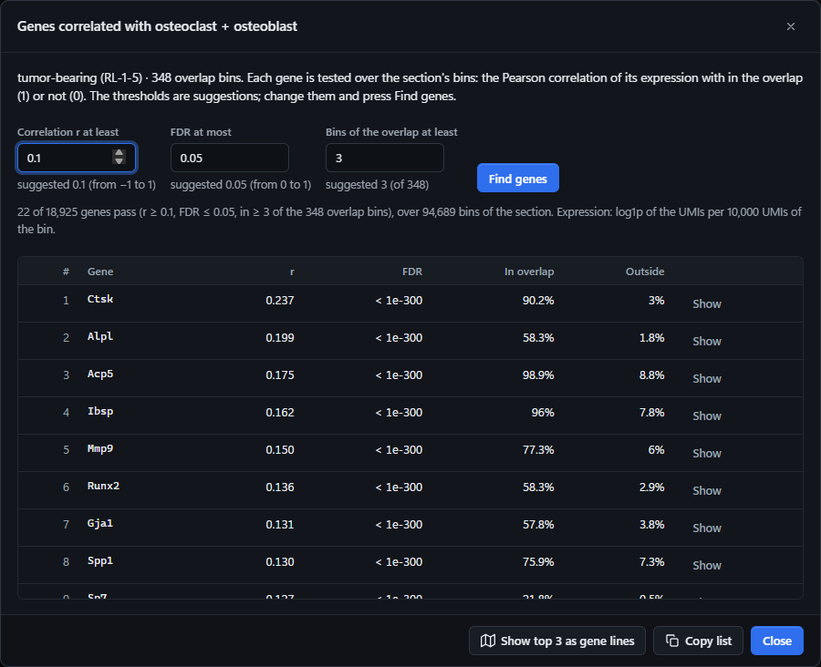

For the example overlap, 22 of 18,925 genes pass; the first are *Ctsk*, *Alpl*, *Acp5*, *Ibsp* and *Mmp9*.

### Top gene

**Top gene** colors every bin by the gene with the most UMIs in the bin and the 8 bins around it (a tie goes to the gene
with the most UMIs in the section). The 18 genes that top the most bins have colors of their own; the others share
**Other genes**. It is a quick, unsupervised look at what dominates each part of the tissue.

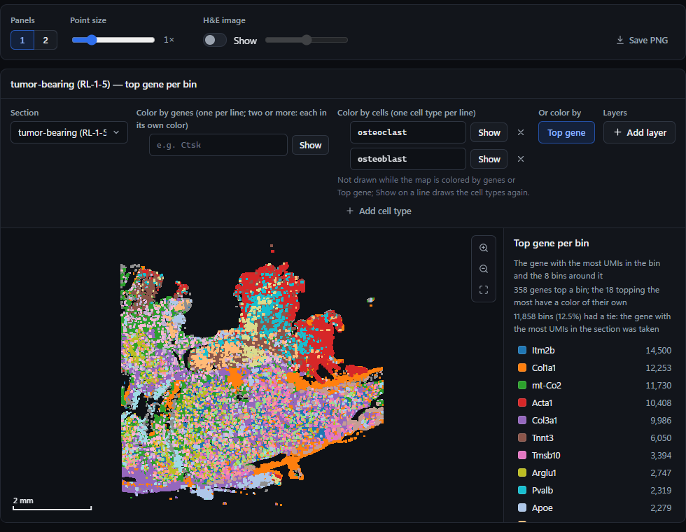

### Compare sections side by side

**Panels** shows up to one panel per section (at most 6: 2 and 3 side by side, 4 in 2 × 2, 5 and 6 in 3 × 2), each
with its own section and coloring. **Pan and zoom → Linked** moves them together. **Color scales → Shared** (on by
default) gives panels colored by the same genes one color range, so that the same color means the same number of UMIs.

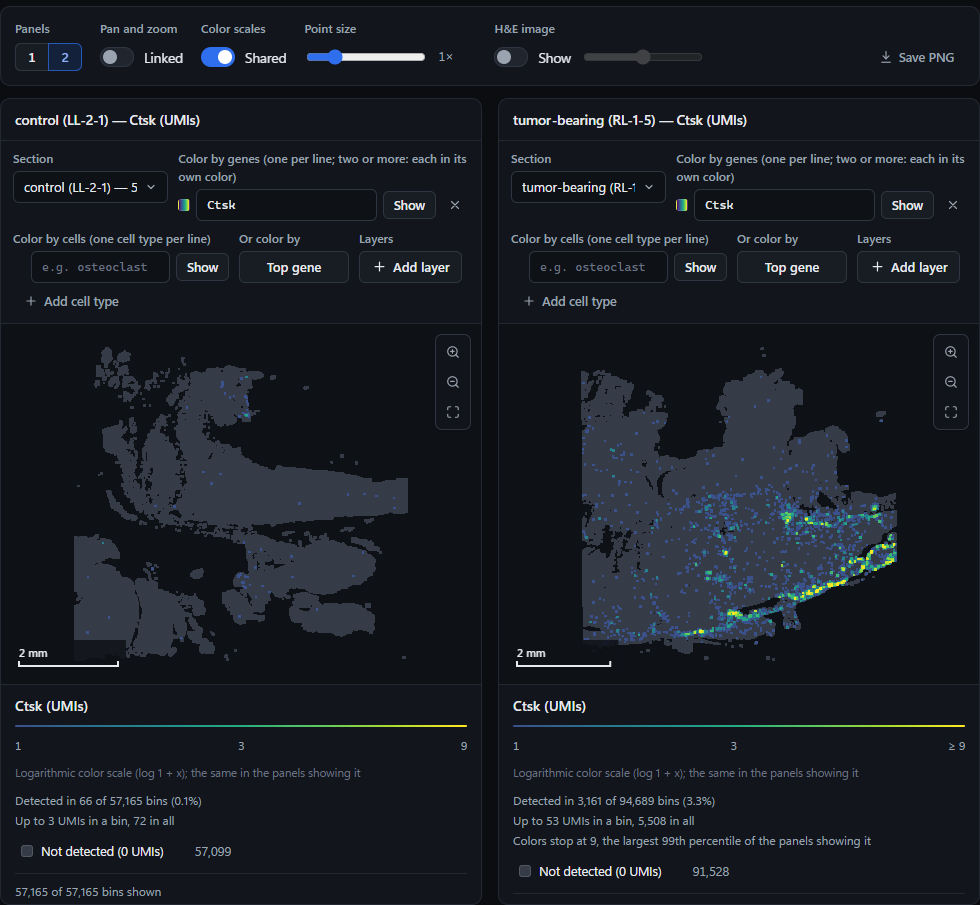

*Ctsk* is detected in 66 bins of the control section and in 3,161 of the tumor-bearing one.

### Bins, legend, mouse and keyboard

* **Hover** a bin: its tissue class, assigned signature, Leiden domain, UMIs and other values, and every gene detected
  in it with its UMIs (the first 150). **Click** a bin to list all its genes, with a filter and **Copy list**.
* **Legend**: click an entry to hide or show it; Alt + click shows only that entry. With no gene line, a click on
  **Every bin (gray)** hides the gray bins.
* **Mouse**: drag to pan; scroll or double-click to zoom (Shift + double-click zooms out).
* **Keyboard**, with the map focused: the arrow keys pan, + and − zoom, 0 fits the section.

## 8. Download the results

**Export** at the top of a finished run downloads one zip file:

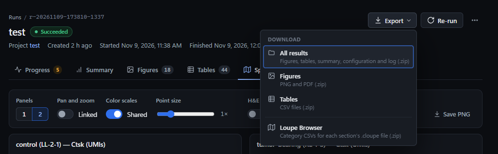

* **All results**: figures, tables, summary, configuration and log. The AnnData objects (`.h5ad`) are not included;
  download them one by one in the Tables tab.
* **Figures**: every figure as PNG and PDF.
* **Tables**: every CSV.
* **Loupe Browser**: the per-bin calls as category files for 10x Genomics Loupe Browser, one per section's `.cloupe`
  file. The README.txt in the zip says which file goes with which `.cloupe` file and how to import it; see also
  [Viewing results in Loupe Browser](README.md#viewing-results-in-loupe-browser).

## 9. Re-run and reproduce

* **Re-run** at the top of a run starts a new run with the same frozen configuration and drawn regions.
* To try other settings, change the project and start a new run; finished runs keep their own configuration.
* **Configuration → Create project from this configuration** copies the sections, parameters and signatures of a run
  into a new project (drawn regions are not copied).
* The Summary records the package versions of the run; with **Deterministic** on, a rerun gives the same numbers.
* The **⋯** menu of a run opens its project or deletes the run.

## Other tissues and gene sets

The defaults are the manuscript's: mouse bone and marrow signatures, and a few steps built around osteoclasts and
osteoblasts in an A549 bone lesion (marked **bone study** under **Parameters → Analysis steps**). Quality control,
Leiden domains, scores and positivity calls, depth matching, the region of interest, the tissue assignment, Moran's I,
the per-bin table, the summary and the maps work with any gene signatures:

1. In **Signatures**, delete the signatures you do not need and add your own: scored genes, core genes and competing
   signatures, with the switches **Positivity call** and **Tissue assignment**.
2. The configuration check (the chip at the top right) lists every setting that still names a removed signature, and
   where to change it. Switch off the bone-study steps you do not need.
3. Gene names must match the probe set exactly: mouse `Ctsk`, human `CTSK`. The data check lists the missing genes.

More in [Using it for other gene groups](README.md#using-it-for-other-gene-groups) and in the app's **Guide**.

## When something goes wrong

| What you see | What to do |
|---|---|
| *No Space Ranger outputs for … in this folder* | The folder has no `square_016um/filtered_feature_bc_matrix.h5`. Choose the section folder, its `outs/` or its `outs/binned_outputs/`. |
| *These files take …; a project may upload 3.0 GB on this server* | Too large for the hosted server: run popcorn [on your own computer](#on-your-own-computer). |
| *Upload failed* | Choose the folder again. |
| Errors in the configuration check or the data check | Each names the setting or the file to fix; the analysis cannot start until they are gone. |
| A gene is *not in the data* | It is not in the probe set (*Bglap* is not in the mouse one), or it is spelled differently (case matters). |
| The run failed | The Progress tab shows the error and the traceback, with a copy button. Fix the cause (often a missing file or a parameter), then **Re-run**. |
| The run ran out of memory or was stopped after 30 minutes | The data is too large for the hosted server: [make the run shorter](#5-start-the-analysis) or run popcorn [on your own computer](#on-your-own-computer). |
| The spatial viewer is empty | The run has not finished, or it stopped before it wrote the per-bin table. |
| Gene maps of a finished run fail after **Remove uploaded data** | Runs keep their results, but their gene maps read the uploaded data: upload it again. |

## On your own computer

popcorn also runs locally: no upload, no size or time limit, and the data stays on your computer. It needs Python 3.10
or newer (3.12 recommended).

```
git clone https://github.com/Asaaaaaa123/Popcorn.git
cd Popcorn
powershell -ExecutionPolicy Bypass -File .\start.ps1      # Windows
./start.sh                                                 # macOS / Linux
```

The first start installs the packages (a few minutes) and opens <http://127.0.0.1:8765>. Everything works as above
except the **Data** tab: instead of uploading, choose the **Data root**, the folder on your computer that holds the
Space Ranger outputs, and click **Detect samples**. Projects and runs are kept in `workspace/`. The
[README](README.md) has the details and the command-line scripts.

> The hosted version is ahead of this repository: it adds the upload described above and a newer spatial viewer.
> Until they are merged, the viewer of a local copy colors the map with one **Color by** menu (tissue class, assigned
> signature, Leiden domain, a number or genes) and adds genes, positivity calls and the region of interest with
> **+ Add layer**; *Color by cells*, *Top gene* and *Correlated genes* are not there yet, and it shows one, two or four
> panels.
